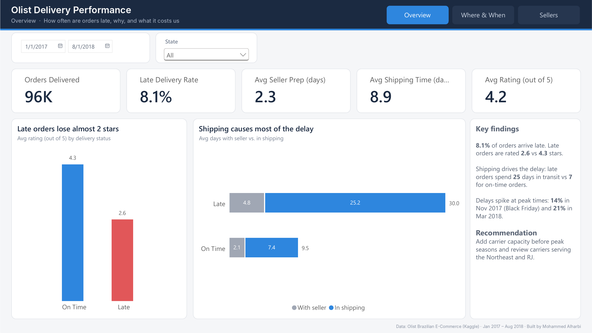
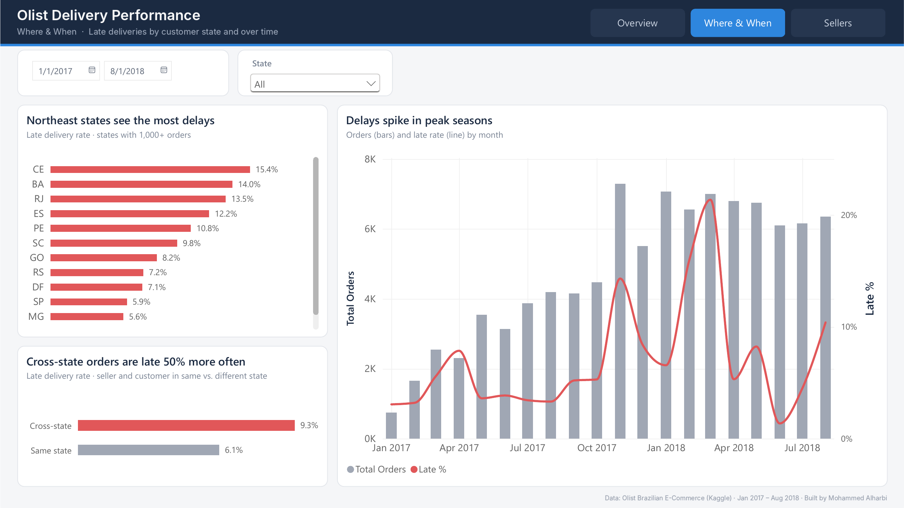
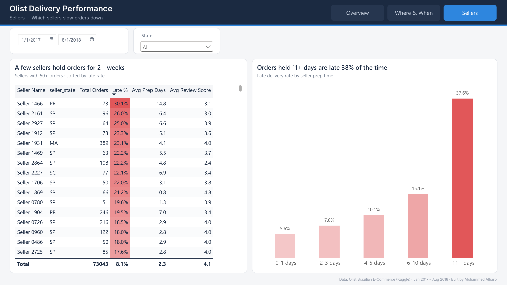

# Olist Delivery Performance — Power BI Dashboard

An operations analysis of ~96,000 delivered orders from Olist, a Brazilian e-commerce marketplace.
The goal: find out **how often orders arrive late, why, and what it costs in customer satisfaction**, then turn that into actions an operations team can take.



---

## Business questions

1. How many orders arrive later than the date promised to the customer?
2. Does a late delivery hurt the customer's rating?
3. Where does the delay happen — with the seller, or in shipping?
4. Which regions and which months are hit hardest?
5. Which sellers slow orders down?

## Key findings

| # | Finding | Evidence |
|---|---|---|
| 1 | **8.1%** of delivered orders arrive late. | 7,822 of 96,203 orders |
| 2 | Late orders are rated **2.6 / 5** vs **4.3 / 5** for on-time orders — almost 2 stars lower. | Avg review score by delivery status |
| 3 | **Shipping, not sellers, drives the delay.** Late orders spend 25 days in transit vs 7 for on-time orders; time with the seller only rises from 2 to 5 days. | Prep vs shipping breakdown |
| 4 | Delays concentrate in the **Northeast** (CE 15.4%, BA 14.0%). **RJ** has the largest number of late orders (1,664). | Late rate by state, 1,000+ orders |
| 5 | Orders shipped **across states** are late 9.3% of the time vs 6.1% within the same state — about 50% more often. | Seller state vs customer state |
| 6 | Delays **spike at peak times**: 14% in Nov 2017 (Black Friday) and 21% in Mar 2018. | Monthly trend |
| 7 | When a seller holds an order for **11+ days**, it is late **38%** of the time (vs 6% for 0–1 days). | Late rate by seller prep time |

## Recommendations

- **Add carrier capacity before peak seasons** (November, and late Q1).
- **Review carrier performance on routes to the Northeast and RJ**, and consider regional fulfilment closer to those customers — cross-state orders take about twice as long.
- **Set a prep-time SLA for sellers** (e.g. ship within 5 days) and follow up with the sellers who regularly exceed it.

---

## Dashboard

| Page | What it answers |
|---|---|
| **Overview** | Headline KPIs, the rating impact of late orders, and where the delay happens |
| **Where & When** | Late rate by customer state, same-state vs cross-state orders, and the monthly trend |
| **Sellers** | Seller scorecard and late rate by seller prep time |

Every page shares the same date and state filters, and page navigation is built into the header.




## How it was built

**Data preparation (Power Query)**
- Kept delivered orders only, and removed 8 orders marked "delivered" with no delivery date.
- Added `Prep Days` (payment approval → handed to carrier), `Shipping Days` (carrier → customer) and an `Is Late` flag.
- Found **1,350 orders where the carrier date is before payment approval** — a recording error. Their prep time was set to blank rather than deleting the orders, so they still count toward the late rate.
- Created readable seller labels (`Seller 0001`, …) in place of the anonymised hash IDs.

**Data model**
- Star schema: `orders` as the fact table, with `customers`, `sellers`, `order_items` and `reviews`.
- Single-direction filters by default; a two-way filter between `orders` and `order_items` only, so seller filters reach order-level metrics.

**DAX measures**
- `Late %`, `Avg Prep Days`, `Avg Shipping Days`, and a review measure that averages **per order** (some orders have several reviews, and the reviews table also includes non-delivered orders):

```DAX
Avg Review Score = AVERAGEX(orders, CALCULATE(AVERAGE(reviews[review_score])))
```

**Design**
- Custom theme, a fixed 1280×720 grid, and one accent colour per meaning (red = late).
- Chart titles state the finding, not just the metric.

**SQL**
- [`sql/analysis.sql`](sql/analysis.sql) reproduces every finding above in SQL (CTEs, joins, `CASE`, window functions), as a cross-check on the Power BI numbers.

## Repository

```
├── olist_operations.pbix     Power BI report
├── olist_operations.pdf      PDF export of the dashboard
├── olist_theme.json          Custom report theme
├── sql/analysis.sql          SQL version of the analysis
└── images/                   Dashboard screenshots
```

## Data

[Brazilian E-Commerce Public Dataset by Olist](https://www.kaggle.com/datasets/olistbr/brazilian-ecommerce) (Kaggle).
Analysis period: January 2017 – August 2018. The raw CSV files are not included in this repository; download them from Kaggle to refresh the report.

## Tools

Power BI (Power Query, DAX) · SQL (SQLite) · Python (pandas) for validation

---

**Mohammed Alharbi** — Data Analyst · [LinkedIn](https://linkedin.com/in/mohammed-alharbi-data) · [Portfolio](https://dsmohammedharbi.github.io)
